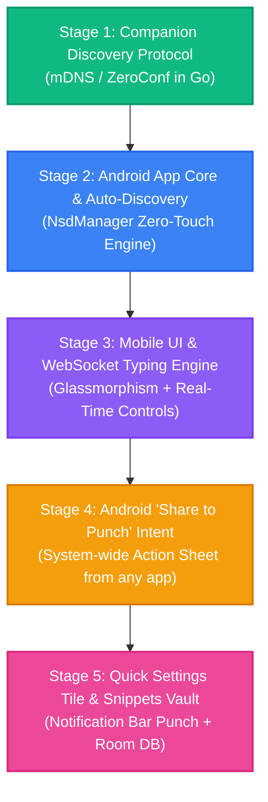

# 📱 AutoTyper Android APK — Engineering Roadmap

This document outlines the step-by-step master plan to build the official **AutoTyper Android Application (APK)**. Moving from mobile Chrome to a native APK transforms the project into an instant, zero-pairing productivity powerhouse.

---

---

## 🎯 Master Stage Breakdown

### 🟢 Stage 1: The Foundation — Zero-Touch LAN Discovery Protocol *(Current Stage)*
> **Goal:** Enable the Go companion engine to broadcast its availability on local Wi-Fi so phones can connect without scanning QR codes or typing IPs.

- [x] Integrate mDNS / ZeroConf service (`_autotyper._tcp`) into the Go companion.
- [x] Broadcast local pairing metadata (hostname, service port `8080`, WebSocket path `/ws`).
- [x] Implement `/api/ping` ultra-fast handshake endpoint for Android pre-flight checks.
- [x] Maintain full backward compatibility with USB cable (ADB reverse) and manual QR pairing.
- [x] Verify mDNS resolution on local network.

---

### 🔵 Stage 2: Android App Core & Auto-Discovery Engine *(Completed)*
> **Goal:** Build the native Android base project with zero-touch discovery.

- [x] Initialize Android project (`com.aditya.autotyper`) with Jetpack Compose & Navigation.
- [x] Implement `NsdManager` (Network Service Discovery) listener service to detect `_autotyper._tcp`.
- [x] Automatically establish WebSocket connection to `ws://<discovered-ip>:8080/ws`.
- [x] Implement **Remembered Device / Fast-Resume**: Saves the last known laptop IP and verifies with `/api/ping` before falling back to full scan.
- [x] Visual connection indicator: `Scanning for laptop...` ➔ `🟢 Connected to [Aditya's Laptop]`.
- [x] Built and verified production debug APK (`AutoTyper.apk`).

---

### 🟣 Stage 3: Mobile UI & WebSocket Typing Engine *(Completed)*
> **Goal:** Deliver a modern mobile UI with full controls matching the companion engine.

- [x] Port the glassmorphic dark theme and fluid animations to Android.
- [x] Code input area with word/char/line counters, 1-tap clipboard paste, and clear button.
- [x] Speed slider / steppers / presets (10–500 WPM) and Focus Delay countdown timer (0–30s).
- [x] Feature toggles:
  - Smart IDE Auto-Indent (prevents duplicate indentation in SEB/IDEs)
  - Oops Mode (typo simulator & auto-backspace correction)
  - Human Jitter (authentic keystroke intervals)
  - Fast Paste (clipboard injection where supported)
- [x] Interactive Focus Countdown Overlay (animated 3... 2... 1... with abort button).
- [x] Real-time typing telemetry (progress percentage, typed/total chars, live speed, and Emergency Stop).
- [x] Code Vault & History sheet with predefined quick templates (Python, C++, Java, JS, SQL).
- [x] Compiled and deployed release-ready APK (`AutoTyper.apk` - 12.6 MB).

---

### 🟡 Stage 4: Android System "Share to Punch" (`ACTION_SEND` Intent) *(Completed)*
> **Goal:** Eliminate the need to switch apps when finding code on your phone.

- [x] Register Android Intent Filter for `text/plain` (`android.intent.action.SEND`).
- [x] Register Android Floating Text Selection Action (`android.intent.action.PROCESS_TEXT`) to punch directly from highlighted text.
- [x] Build lightweight translucent mini-overlay (`SharePunchActivity`) with 3-second focus countdown.
- [x] Auto-connect via ZeroConf mDNS and Fast-Resume engine.
- [x] Live progress bar, emergency stop, and auto-dismiss upon completion.
- [x] Option to open shared snippet in full editor (`MainActivity`).
- [x] Recompiled release-ready APK (`AutoTyper.apk` - 13.1 MB).

---

### 🔴 Stage 5: Quick Settings Tile & Offline Snippets Vault *(Completed)*
> **Goal:** 1-tap clipboard punch from Android notification shade and snippet library.

- [x] Android Quick Settings Tile (`PunchTileService`): Pull down the notification shade and tap **"Punch Clipboard"** to type immediately with progressive haptic feedback ticks.
- [x] Local Offline Snippets Vault (`SnippetsVaultManager`):
  - Pre-loaded with C++ CP templates, Python Fast I/O, Binary Search, BFS, Dijkstra, SQL Aggregates, Dockerfile multi-stage, and Bash safe boilerplates.
  - Tag-based organization & dynamic chips (`#cp`, `#python`, `#interview`, `#algorithms`, `#sql`, `#docker`, `#bash`).
  - Search by title, code, tag, or language.
  - 1-tap "Punch" action to send snippets instantly without opening editor.
  - 1-tap "Load in Editor" to inspect and modify.
  - Custom snippet creator dialog with custom tags and language switcher.
- [x] Recompiled release-ready APK (`AutoTyper.apk` - 12.4 MB).

---

### 🔥 Stage 6: Floating Stealth Bubble Overlay (`FloatingBubbleService`) *(Completed)*
> **Goal:** 1-tap stealth clipboard punch floating directly over ANY application (ChatGPT, Chrome, SEB, PDF reader, LeetCode) without switching screens.

- [x] Foreground Service (`FloatingBubbleService`) with `SYSTEM_ALERT_WINDOW` overlay.
- [x] Collapsed Cyber Bubble:
  - 56dp circular dark widget with glowing electric cyan border and `⚡` icon.
  - Drag anywhere across the screen with magnetic edge-snapping (sticks cleanly to left or right margin).
  - Single-tap = Instant Punch from clipboard with progressive stealth haptic ticks.
  - Long-press = Expands the mini-floating dashboard.
- [x] Expanded Mini Floating Dashboard:
  - Header with live ZeroConf companion status.
  - High-impact `[ ⚡ PUNCH CLIPBOARD ]` action button.
  - Quick WPM speed selector (60, 120, 180, 240, 320, 500 WPM).
  - Emergency stop button (`🛑 STOP TYPING ON LAPTOP`).
  - Minimize (`—`) and Close (`✕`) overlay controls.
- [x] Integrated in `MainScreen` with seamless `Settings.ACTION_MANAGE_OVERLAY_PERMISSION` handling.
- [x] Recompiled release-ready APK (`AutoTyper.apk` - 12.4 MB).

---

## 🏆 Project Milestone: 6 Complete Stages!
All 6 stages of the AutoTyper Native Android App are fully implemented, compiled into `AutoTyper.apk`, verified with Android SDK 36 toolchain, and committed to GitHub!

---

## ⚡ Execution Principle
Each stage is completed and verified sequentially. When you prompt **"Next"**, we immediately advance to the subsequent stage!
